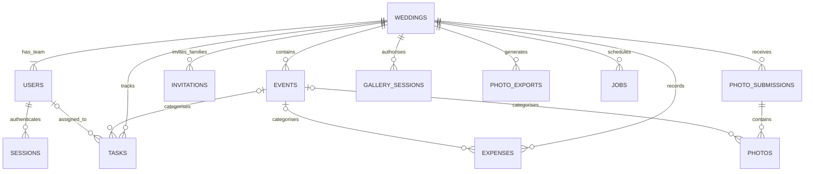

# Wedding Application — Database Design

Version: 1.0  
Date: 15 October 2026  
Status: Implementation design based on approved product and architecture  
Related documents: [PRD](./PRD.md), [System Architecture](./SYSTEM_ARCHITECTURE.md)

This document defines the MongoDB model. It does not create a database or deploy schema changes. The auth slice has an explicit migration; remaining feature validators/migrations will be added with those features.

## 1. Database conventions

- One MongoDB Atlas database per environment, with shared collections across weddings. Version one does not require sharding or a separate database per wedding.
- Every wedding-owned document contains `weddingId: ObjectId`. The `weddings` collection uses its own `_id` as the boundary.
- Unless explicitly excluded, documents have `_id: ObjectId`, `createdAt: Date`, `updatedAt: Date`, and `schemaVersion: Int32` (initially 1).
- Mutable business records also have `revision: Int32` (initially 1), `createdBy: ObjectId` and `updatedBy: ObjectId` where a team actor exists. Guest/system actions use explicit actor type rather than a fictitious account.
- All instants use BSON Date in UTC. Calendar dates use validated `YYYY-MM-DD` strings and an IANA timezone. Display dates and wedding URL dates use **DD-MM-YYYY**.
- Optional reference fields use `null` consistently. Optional indexed unique secrets are omitted when absent, with partial indexes restricted to strings.
- Store money as BSON Long integer paise, currency `INR`. Validate safe integer conversion in TypeScript; never use floating-point arithmetic for totals. API serialisation must preserve precision.
- Enums are lowercase stable machine values; UI labels are independent.
- Do not store photo bytes, public S3 URLs, passwords in plaintext, raw session tokens, or raw secret access tokens in MongoDB.
- Enforce types/enums/bounds with MongoDB validators and application validation. Cross-collection ownership and workflow constraints require service-layer checks; MongoDB references are not foreign keys.

## 2. Relationship map



An invitation references multiple event IDs. General tasks/photos and shared expenses have `eventId: null`. Small fixed subdocuments are embedded; growing lists such as events and photos are separate collections.

## 3. Collections and schemas

Field tables describe additional fields beyond the common conventions. “Required” means required in the stored document unless a conditional rule is stated.

### 3.1 `weddings`

| Field | Type | Requirement / meaning |
| --- | --- | --- |
| couple | Object | Required: `partner1Name`, `partner2Name` strings |
| mainDate | String | Required valid calendar date; retention anchor |
| timezone | String | Required; default `Asia/Kolkata` |
| slug | String | Required unique address; example `avani-swar-14-02-2027` |
| slugLockedAt | Date/null | Set on first publication; prevents subsequent slug changes |
| publicationStatus | Enum | `draft`, `published` |
| publishedAt | Date/null | First publication instant |
| website | Object | `themeId`, `intro`, `welcomeMessage`, supported `accentColor`, optional `coverPhotoId` |
| location | Object/null | City/area and optional coordinates for vendor-search defaults |
| latestAnnouncement | Object/null | Message, updatedAt, updatedBy; one current announcement |
| gallery | Object | `uploadsEnabled`, `privateLinkEnabled`, `privateLinkVersion`, optional `privateTokenHash`, `rotatedAt` |
| photoExpiryAt | Date | Required: start of day eight after mainDate in timezone |
| retentionVersion | Int32 | Increment on date/timezone changes affecting retention |
| mediaCleanup | Object | `state`: idle/queued/running/complete/failed; lastAttemptAt, completedAt, safe error code |

Theme IDs are the three implemented variants, with final visual names chosen during design. Cover images reference managed photo records and expire under the photo policy; use a theme fallback after expiry. Event banners must follow the same rule if added. This avoids leaving original wedding photos accessible through website decoration after gallery expiry.

There is one Admin per wedding as a version-one implementation default. Enforce at most one with a partial unique user index and create the wedding/Admin together in a transaction. Do not disable or delete that sole Admin through ordinary team management.

### 3.2 `users`

| Field | Type | Requirement / meaning |
| --- | --- | --- |
| weddingId | ObjectId | Required, immutable after account creation |
| emailNormalized | String | Required, globally unique; use a consistent normalisation policy |
| displayName | String | Required |
| passwordHash | String | Required password hash with algorithm parameters |
| role | Enum | `admin`, `manager` |
| status | Enum | `active`, `disabled` |
| sessionVersion | Int32 | Increment to invalidate existing sessions |
| passwordChangedAt | Date | Required |

Do not apply provider-specific transformations such as removing dots or plus tags from emails. Guests and private-link viewers are not user accounts. User records are disabled rather than removed so expense/task attribution remains meaningful.

### 3.3 `sessions`

Required: `weddingId`, `userId`, `tokenHash: String`, `sessionVersion: Int32`, `expiresAt: Date`. Optional `revokedAt: Date`, `lastSeenAt: Date`.

Check expiry, revocation, user state, current role, account wedding and session version on every authenticated request. TTL removes expired records later; it does not determine whether a session is valid.

### 3.4 `authTokens`

Required: `purpose` (`manager_invite`, `password_reset`), `weddingId`, `tokenHash`, `expiresAt`, `usedAt: Date/null`. Manager invitations contain `emailNormalized`, `invitedBy` and optionally a display name. Password resets contain `userId`.

Store only hashes of random high-entropy tokens. Claim/consume tokens atomically; Manager creation and invitation consumption share a transaction. Reject accepting an invite when the email already belongs to a different wedding. Password reset increments the user's session version.

### 3.5 `events`

| Field | Type | Requirement / meaning |
| --- | --- | --- |
| weddingId | ObjectId | Required |
| name | String | Required |
| description, dressCode, instructions | String | Optional bounded text |
| startAt | Date | Required UTC instant interpreted using wedding timezone |
| endAt | Date/null | If supplied, after startAt |
| venue | Object | Required name/address; optional mapUrl and coordinates |
| contacts | Array | One or two `{name, phone}` objects for published events |
| status | Enum | `not_started`, `in_progress`, `completed` |
| sortOrder | Int32 | Tie-breaker for same-time events |
| stream | Object/null | Validated YouTube reference/URL and enabled boolean |
| archivedAt | Date/null | Removed from active schedule when set |

Status is manually controlled. Archive events rather than cascade-delete expenses, photos or tasks. Archiving an invited event requires confirmation; invitation selection and estimates operate on active events while historical references remain intact.

### 3.6 `invitations`

Required: `weddingId`, `familyDisplayName`, `contactName`, `eventIds: ObjectId[]`, `tokenHash: String`, `tokenVersion: Int32`, `sentStatus` (`not_sent`, `sent`), `sentAt: Date/null`, `archivedAt: Date/null`. Optional `phone`.

- Require at least one distinct active event at creation; all event IDs belong to this wedding.
- Sent status and timestamp change together. Re-sharing leaves the same record/count intact.
- Store no RSVP or attendee-limit field in version one.
- Token rotation invalidates the previous invitation link without changing family identity or sent status.
- For later re-sharing, store the random token using application-layer authenticated encryption in `tokenCiphertext` with `tokenKeyVersion`, in addition to its lookup hash. Keep encryption keys outside MongoDB. Never return token material in general list responses; expose the reconstructed link only to authorised team actions. Hash-only storage cannot recover an existing shareable URL.
- The same recoverable encrypted-secret approach applies to `weddings.gallery.privateTokenCiphertext/privateTokenKeyVersion` so the team can copy an existing private gallery link without rotating it.

### 3.7 `tasks`

Required: `weddingId`, `title`, `eventId: ObjectId/null`, `assigneeId: ObjectId/null`, `status` (`todo`, `in_progress`, `done`), `dueDate: String/null`, `completedAt: Date/null`, `archivedAt: Date/null`. Optional description.

Due dates are calendar dates in the wedding timezone. A task becomes overdue after the end of its due date if not done. Assignees must be active team members of the same wedding. Reopening clears completedAt. Assignment never restricts Admin/Manager editing.

### 3.8 `expenses`

| Field | Type | Requirement / meaning |
| --- | --- | --- |
| weddingId | ObjectId | Required |
| eventId | ObjectId/null | Null means shared wedding expense |
| description, category | String | Required |
| vendorName, notes | String | Optional |
| currency | String | Always `INR` |
| costPaise | Long | Required nonnegative integer |
| payments | Array | Embedded entries described below |
| archivedAt | Date/null | Removal from active totals while preserving history |

Payment entry: `_id`, `idempotencyKey`, positive `amountPaise: Long`, `paidByName`, optional `paidByUserId`, `paymentDate: YYYY-MM-DD`, optional method/notes, createdAt/createdBy. A payer may be a family member without an account.

Calculate paid = sum(payments), outstanding = max(cost − paid, 0), and overpaid = max(paid − cost, 0). Flag overpayment explicitly; do not disguise it as negative outstanding. Aggregated total outstanding is the sum of individual outstanding balances, so one vendor's overpayment does not cancel another vendor's unpaid amount.

Use a revision-guarded atomic update to add/edit payments. Check idempotency keys within the document; a unique multikey index alone does not enforce uniqueness between entries inside one array. Proposed operational bound: 500 payment entries per expense, well above anticipated pilot use; migrate payments to a separate collection if that becomes limiting.

### 3.9 `photoSubmissions`

Required: `weddingId`, `source` (`guest`, `team`), `uploaderDisplayName`, `uploaderUserId: ObjectId/null`, `defaultEventId: ObjectId/null`, `submissionKey: String` for client retries. Optional hashed upload-session reference and expiry.

This groups one upload batch/session. Matching display names do not imply the same person. Changing an individual photo's event is permitted without moving other batch photos. Never expose submission authorisation secrets in gallery output.

### 3.10 `photos`

| Field | Type | Requirement / meaning |
| --- | --- | --- |
| weddingId, submissionId | ObjectId | Required |
| eventId | ObjectId/null | Event or General |
| source | Enum | guest/team, copied for efficient filtering |
| clientUploadKey | String | Required retry/idempotency key within wedding |
| processingStatus | Enum | uploading/processing/ready/failed |
| moderationStatus | Enum | pending/approved/rejected |
| audience | Enum | public/family_only; default family_only |
| storage | Object | Staging/original/thumbnail keys, optional S3 version IDs, validated MIME, byte size and dimensions |
| uploadExpiresAt | Date | Deadline for unfinished upload cleanup |
| expiresAt | Date | Materialised wedding photo expiry for cleanup, never sole authorisation source |
| retentionVersion | Int32 | Version of wedding retention when copied |
| reviewedBy, reviewedAt | ObjectId/null, Date/null | Required for moderation decisions |
| deletionState | Enum | active/requested/deleting/deleted/failed |
| deletedAt | Date/null | Physical deletion confirmation |
| processingErrorCode | String/null | Safe operational code, no secrets |

Do not TTL-delete these documents: the S3 keys must survive until physical cleanup completes. Guest approval and audience are independent. Team uploads still need successful processing before viewing. Store only immutable final object keys; upload authorisation targets separate staging keys.

### 3.11 `gallerySessions`

Required: `weddingId`, `tokenHash`, `privateLinkVersion`, `expiresAt`. These sessions are view-only and separate from authenticated sessions. Validate against current `gallery.privateLinkEnabled`, generation, publication and photo expiry on every request. Session lifetime cannot extend past photo expiry. A revoked generation does not need immediate record deletion to deny access.

### 3.12 `photoExports`

Required: `weddingId`, `requestedBy`, `idempotencyKey`, `status` (`queued`, `processing`, `ready`, `failed`, `deleting`, `deleted`), `scope` (approved public only or all approved), `expiresAt`, `retentionVersion`. Optional `objectKey`, byte size, failure code and completion/deletion timestamps.

Only Admin/Manager may request/download exports. Recheck their access and wedding expiry on download. Exports expire no later than gallery media; retain storage references until archive deletion is confirmed. Pending/rejected images are excluded.

### 3.13 `jobs`

Required: `weddingId`, `type` (photo_process/media_cleanup/export_generate), `payload` with record IDs, `idempotencyKey`, `status` (queued/running/completed/failed), `attempts`, `maxAttempts`, `nextRunAt`, `leaseUntil: Date/null`, `leaseOwner: String/null`, `leaseVersion: Int32`. Optional safe error code, completedAt and `purgeAt`.

Claim atomically with a lease, increment leaseVersion, and complete only if owner/version still match. Stale workers cannot publish a completed result. External operations must be idempotent because a lease does not provide exactly-once execution. Assign purgeAt only after terminal completion and required storage cleanup; running jobs never expire through TTL.

### 3.14 `auditLogs`

Required: `weddingId`, actor type (`user`, `system`), optional actorId, action, entity type/ID, timestamp, request correlation ID. Keep a bounded summary or changed field names; never log raw credentials, private links, photo URLs or full invitation contact data. These logs explain important changes, including access revocation, event changes, expense edits and photo moderation. Operational retention is to be configured before launch.

## 4. Index specification

All collections receive MongoDB's `_id` index. The following are initial additional indexes; confirm usage with representative query plans before production.

| Collection | Keys | Options / purpose |
| --- | --- | --- |
| weddings | `{slug: 1}` | Unique |
| weddings | `{photoExpiryAt: 1, "mediaCleanup.state": 1}` | Expiry sweeper |
| users | `{emailNormalized: 1}` | Unique globally |
| users | `{weddingId: 1, role: 1}` | Unique only for documents with role=admin; partial filter |
| users | `{weddingId: 1, status: 1}` | Team listing |
| sessions | `{tokenHash: 1}` | Unique |
| sessions | `{expiresAt: 1}` | TTL, expireAfterSeconds=0 |
| sessions | `{userId: 1}` | Session revocation |
| authTokens | `{tokenHash: 1}` | Unique |
| authTokens | `{expiresAt: 1}` | TTL, expireAfterSeconds=0 |
| events | `{weddingId: 1, archivedAt: 1, startAt: 1, _id: 1}` | Active chronological schedule |
| invitations | `{tokenHash: 1}` | Unique |
| invitations | `{weddingId: 1, archivedAt: 1, sentStatus: 1}` | Counts and lists |
| tasks | `{weddingId: 1, archivedAt: 1, status: 1, dueDate: 1}` | Open/overdue tasks |
| tasks | `{weddingId: 1, assigneeId: 1, status: 1}` | My tasks |
| expenses | `{weddingId: 1, archivedAt: 1, eventId: 1}` | Active expense list |
| expenses | `{weddingId: 1, category: 1}` | Category filters |
| photoSubmissions | `{weddingId: 1, submissionKey: 1}` | Unique |
| photos | `{weddingId: 1, clientUploadKey: 1}` | Unique |
| photos | `{weddingId: 1, deletionState: 1, processingStatus: 1, moderationStatus: 1, audience: 1, createdAt: -1, _id: -1}` | Public gallery |
| photos | `{weddingId: 1, moderationStatus: 1, createdAt: -1, _id: -1}` | Moderation/private gallery base |
| photos | `{weddingId: 1, submissionId: 1}` | Uploader batch |
| photos | `{expiresAt: 1, deletionState: 1}` | Cleanup only; not TTL |
| gallerySessions | `{tokenHash: 1}` | Unique |
| gallerySessions | `{expiresAt: 1}` | TTL, expireAfterSeconds=0 |
| photoExports | `{weddingId: 1, idempotencyKey: 1}` | Unique |
| photoExports | `{expiresAt: 1, status: 1}` | Cleanup only; not TTL |
| jobs | `{weddingId: 1, idempotencyKey: 1}` | Unique |
| jobs | `{status: 1, nextRunAt: 1}` | Claim queued work |
| jobs | `{status: 1, leaseUntil: 1}` | Recover abandoned work |
| jobs | `{purgeAt: 1}` | TTL, expireAfterSeconds=0; terminal jobs only |
| auditLogs | `{weddingId: 1, timestamp: -1}` | Wedding change history |

At approximately 200 photos per wedding, event/source filters can operate within the indexed wedding gallery result. Add specialised indexes only when measured query patterns justify them. Never create a compound TTL index; expiration uses a single Date field.

## 5. Core query patterns

Examples below are illustrative MongoDB syntax. `weddingId` comes from trusted session/link resolution. Use explicit projections to exclude secrets.

### Management read/update

```javascript
db.tasks.find({ weddingId, archivedAt: null, status: "todo" });

db.events.updateOne(
  { _id: eventId, weddingId, revision: expectedRevision, archivedAt: null },
  { $set: { startAt: newStartAt, updatedBy: userId, updatedAt: now },
    $inc: { revision: 1 } }
);
```

No matched record means not found/forbidden/stale; resolve safely without leaking another wedding's resource existence.

### Public photos

First verify the wedding is published and `now < wedding.photoExpiryAt`. Then:

```javascript
db.photos.find({
  weddingId,
  deletionState: "active",
  processingStatus: "ready",
  moderationStatus: "approved",
  audience: "public"
}).sort({ createdAt: -1, _id: -1 }).limit(30);
```

Return only public metadata and separately authorised short-lived media URLs. For the private gallery, verify current gallery session/version and remove only the audience predicate. Never remove moderation/deletion checks. Add a `(createdAt, _id)` cursor for subsequent pages; do not use unlimited offsets for growing galleries.

### Invitation estimates

Count active invitations where sentStatus=sent. Wedding range is count × 2 to count × 3. For an event, add `eventIds: eventId`. Never sum per-event counts to obtain unique wedding families.

### Expense totals

Match this wedding's active expenses, sum each document's payment entries, derive outstanding/overpaid per expense, then aggregate. Payer filtering operates on payment entries and must distinguish “payments made by this payer” from “entire costs of expenses this payer contributed to.”

### Overdue tasks

Compare dueDate against today's local `YYYY-MM-DD` string using simple binary ordering, excluding null dates, done and archived tasks. Validated ISO date strings sort chronologically. No scheduled job is needed to update an overdue flag.

## 6. Atomicity and consistency rules

| Operation | Strategy |
| --- | --- |
| Create wedding + Admin | Transaction, with globally unique email and unique slug retry |
| Accept Manager invite | Transaction: consume unexpired token and insert account; reject existing cross-wedding email |
| Reset password | Transaction: consume token, update password hash, increment sessionVersion |
| Edit event/task/expense | Single-document atomic update guarded by revision |
| Add payment | Revision + per-expense idempotency guard; same retry returns existing result |
| Create upload + job | Transaction or recoverable outbox pattern; no successful response without durable work record |
| Rotate private link | Atomic wedding update: new hash/ciphertext and increment version |
| Change main date/timezone | Atomic wedding expiry/version update plus durable rescheduling; synchronise copied expiry fields asynchronously |
| Delete photo | Mark requested, enqueue cleanup; remove storage first, then confirm deleted |

The wedding's expiry is authoritative even while per-photo/job copies are being reconciled. A retention version guards stale jobs. Workers must recheck current expiry before deleting; a cleanup worker must coordinate with date changes using a per-wedding cleanup lease/state. Once irreversible deletion has begun, a date extension cannot promise recovery of already deleted objects.

Use durable writes for financial/access/lifecycle changes and retry transient transaction errors safely. Immutable idempotency keys prevent duplicate effects from retried client requests. No transaction spans MongoDB and S3; reconcile failed external operations through durable jobs.

## 7. Validation and visibility invariants

- Immutable weddingId; all related IDs and assignees verified within that wedding.
- Require a valid main calendar date, timezone and computed expiry; never parse DD-MM-YYYY as an internal date implicitly.
- Event end follows start, contacts meet the published-site requirements, and stream/map URLs use permitted protocols.
- Unique invitation event IDs; sentAt present only when sentStatus=sent.
- Task status and completedAt remain consistent.
- Positive payment amounts and nonnegative cost; explicit overpayment representation.
- Guest photo defaults pending/family_only; ready storage required before gallery delivery.
- Private sessions match current generation; role/team revocation is checked from current account state.
- Expense records, guest lists, internal tasks, tokens and unpublished photos never appear in public projections.

Use `$jsonSchema` validators with required fields, bsonType, enums and reasonable string/array limits. Application validation additionally enforces calendar validity, same-wedding references and state transitions. A schema validator does not replace authorisation.

## 8. Retention and deletion

For a wedding on 14-02-2027 in Asia/Kolkata, photo access expires at local 22-02-2027 00:00, stored as `2027-02-21T18:30:00.000Z`.

1. Request-time checks deny uploads, viewing URLs and exports at expiry.
2. A periodic sweeper discovers expired weddings and queues cleanup, even if the initial job was missed.
3. Mark records deleting, remove originals/thumbnails/staging/export archives and retained S3 versions if any.
4. Mark deletion confirmed only after successful removal; retry partial failures.
5. Retain minimal cleanup metadata; remove unnecessary uploader personal details/object references according to the operational metadata policy.

Do not use MongoDB TTL for photos or exports before S3 cleanup. Session/token TTL deletion is asynchronous, so expiry must be enforced in queries/application code. Archived business records remain accessible to authorised history/recovery workflows, not public listings or active totals.

## 9. Migrations, backups and validation plan

- Keep versioned migrations for collections, validators, indexes and data backfills. Record applied migrations in a small `schemaMigrations` collection with unique migration ID and appliedAt.
- Create critical unique indexes before accepting writes. Audit existing duplicates before applying new uniqueness constraints.
- Backfill before tightening validators; deploy compatible readers/writers during field transitions.
- Configure Atlas backups and test restoration in a separate environment. Restored sessions/tokens should be invalidated before serving traffic.
- Restore procedures must preserve present-day expiry checks and run cleanup reconciliation. A database restore must not re-authorise expired media.
- Verify cross-wedding queries, unique account/slug handling, token replay, concurrent payment edits, gallery visibility, rotation, expiry boundaries and job retries.
- Review query plans with realistic seed data, including more than one wedding; do not benchmark only an empty database.

## 10. Implementation choices to resolve

The document selects concrete modelling defaults without changing product scope. During implementation, finalise the MongoDB driver/ODM, precise validator length limits, session and auth-token lifetimes, audit/job metadata retention, and key management for recoverable invitation/private links.

Google vendor results are not a permanent application collection. Fetch them through the integration and cache only as permitted by the provider. YouTube streams are embedded event settings. Theme content and current announcement live on the wedding; no extra collections are needed for these version-one features.

## 11. Development cluster connection

See [MongoDB Atlas — Development Setup](./MONGODB_DEVELOPMENT.md) for the verified cluster hostname, database username, password-free connection templates, proposed backend configuration, setup steps and troubleshooting. Compass connectivity was verified on 17 October 2026; application schema deployment remains pending.

## 12. Implemented authentication persistence — 18 October 2026

The official MongoDB driver is used. `server/src/migrations/001-auth-foundation.ts` creates validators/indexes only for users, weddings, sessions, auditLogs and authRateLimits, and records `001-auth-foundation` in schemaMigrations. The other collections/indexes described above remain planned. Normal startup never applies migrations or seeds data.

- Users use trimmed/lowercase globally unique email (no provider-specific rewriting), names up to 100 characters, Argon2id password hashes (19 MiB memory, two iterations, parallelism one) and sessionVersion=1. At most one Admin per wedding is enforced by a partial unique index on weddingId/role for role=admin. Signup atomically inserts wedding, Admin, authenticated session and account_registered audit entry; a failure rolls back all four.
- Draft wedding initialisation includes the approved timezone/theme, mainDate, collision-safe slug, unlocked slug/publication fields, empty website text, null cover/location/announcement, gallery defaults, revision=1 and actor IDs. photoExpiryAt is local midnight eight calendar days after mainDate, converted to UTC; retentionVersion=1 and cleanup is idle. No public website or storage job is enabled by registration.
- Authenticated sessions contain only SHA-256 hashes of random 256-bit tokens, valid userId/weddingId, absolute expiresAt and revokedAt=null initially. Session lifetime defaults to 24 hours. TTL on expiresAt handles eventual deletion; application checks current account/session/wedding state independently. Login rotates the prior browser session; logout sets revokedAt and clears cookies.
- `authRateLimits` is infrastructure data, not wedding-owned business data: it must protect requests before identity exists. Its `_id` is a SHA-256 digest of limiter scope, IP or normalised email, and window; it stores only count and expiresAt, with TTL on expiresAt. It intentionally has a string ID and no weddingId/schemaVersion/createdAt/updatedAt. Atomic increments aggregate limits across instances. No raw email/IP is stored in these records.
- Pre-auth CSRF uses a random HttpOnly context cookie and signed double-submit token; no incomplete user or authenticated session is persisted. Password-reset/invitation authTokens are implemented in migration 002; see the M2 notes below.
- `schemaMigrations` is infrastructure metadata with string IDs; applied entries have appliedAt. A distinct `__migration_lock` record has a random owner and acquiredAt; the runner deletes only its own lock. It does not expire automatically. After a hard crash an operator must confirm the runner has stopped before clearing this one lock. Partial migration execution can then be retried idempotently; history markers are never removed automatically.
- Explicit Atlas integration/browser tests create randomly named `ws_test_auth_<24 hex>` databases and drop only the exact database they created. These tests never write to the configured application database or seed the owner's real wedding.

Run `npm run db:migrate` locally or the compiled server's `db:migrate:production` command in the target environment. Authentication returns 503 until its migration marker is present. Review/back up existing data before deploying validators or unique indexes. Future feature migrations must extend these validators intentionally rather than treating this initial subset as the complete product schema.

## References

- [MongoDB schema validation](https://www.mongodb.com/docs/manual/core/schema-validation/)
- [MongoDB index properties](https://www.mongodb.com/docs/manual/core/indexes/index-properties/)
- [Unique indexes and schema validation](https://www.mongodb.com/docs/manual/tutorial/unique-indexes-schema-validation/)
- [MongoDB TTL indexes](https://www.mongodb.com/docs/manual/core/index-ttl/)


## M2 implementation notes — 18 October 2026

Migration `002-team-recovery` adds strict `authTokens` and `jobs` validators/indexes without seeding business records. It runs explicitly after 001 and uses the same owner-held migration lock. The jobs validator currently permits only `auth_email`; later lifecycle work must extend it before adding photo/export jobs.

Auth tokens include purpose, wedding, SHA-256 token hash, normalised recipient, optional display name/user, inviter, optional user session version, absolute expiry, nullable used/revoked times, revision and common record fields. Unique hash and partial unique wedding/email Manager-invitation indexes prevent duplicate capabilities/invitations. Token expiry has the baseline TTL index; invitation summaries therefore remain only until token cleanup and do not form permanent history. Reset tokens are tied to the current user session version. Used/expired/revoked state is enforced transactionally before TTL cleanup.

Manager creation, token consumption, session creation, queued-job cancellation and audit insertion commit together. Reset changes password/session version, consumes the token, invalidates remaining reset tokens, revokes sessions and writes an audit in one transaction. Team mutations also write-lock/revalidate the actor so a stale Admin snapshot cannot race account revocation. Users gain optional `teamRevision` (defaults to 1 for existing records) and internal `accessRevision` for serialising access operations; the sole-Admin/global-email indexes remain unchanged.

Durable email requires recoverable message bytes until dispatch. `authTokens` remains hash-only; a separate AES-256-GCM encrypted email envelope lives temporarily in `jobs`, authenticated with the job ID and a private key stored outside MongoDB. Jobs contain token ID/revision, immutable provider idempotency key, status/outcome, bounded attempts/backoff, expiry, first-attempt timestamp and owner/version/expiry-fenced leases. Envelopes are cleared on terminal outcome. No API returns them. This extension resolves the previously missing durable-email job contract; it does not make auth tokens re-shareable. See TEAM_RECOVERY.md for outbox handling, key replacement and the provider retry horizon.

Live jobs have no TTL. Terminal job/audit metadata retention still requires an operating decision before production. Existing wedding/photo retention and archive access rules are unchanged. These notes describe implementation, not successful Atlas migration or provider verification; consult PROJECT_STATUS.md for actual evidence.


## M3 implementation notes — 18 October 2026

Migration 003 adds strict event validation and a weddingId/archivedAt/startAt/sortOrder/_id schedule index, with the existing owner-held migration lock/history pattern. Event drafts may lack venue/contacts; publication validation requires one or two contacts and venue name/address for every active event. Streaming remains null until M7. No photo job or managed cover reference is enabled.

Wedding/event/audit mutations use MongoDB transactions, revalidate/write-lock the acting active account and always advance the parent wedding revision. This makes publication validation conflict with simultaneous event edits instead of publishing an inconsistent schedule. Events maintain their own revisions; archive preserves the document/references. Public read transactions project only published wedding content and active events. Safe nested projections explicitly whitelist website/couple/venue/contact fields and always return a null unmanaged cover reference.

Date/timezone changes recalculate authoritative photoExpiryAt and increment retentionVersion when changed, without rewriting event instants. Access extension is blocked after cleanup may have started (running/complete/failed); no date change restores deleted bytes. Published slug locks survive unpublication. Before first publication, unrelated saves preserve signup collision suffixes; actual name/date changes may regenerate the draft address with uniqueness enforcement.

This section records the implemented data path, not a claim that a production migration or deployment occurred. See PROJECT_STATUS.md for test results and development migration state.
