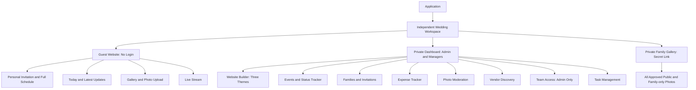

# Indian Wedding Application — Version 1 PRD

Status: Version 1 product baseline; implementation defaults identified separately  
Document version: 1.0  
Date: 15 October 2026  
Initial pilot: The founder's own wedding

## 1. Product purpose

Help couples and their families coordinate an Indian wedding and give guests one reliable place to find invitations, event information, current updates, contacts, and photos.

The couple creates a wedding website from one of three themes. An Admin and selected Managers maintain the wedding. Guests open links or scan QR codes without creating accounts.

The application supports multiple independent weddings at the same time. Each authenticated account belongs to exactly one wedding; there is no wedding switcher.

## 2. Goals and scope

### Goals

- Let a couple create and publish a personalised wedding website without coding.
- Reduce repeated questions about event times, venues, and what is happening now.
- Make family invitations clear while allowing all guests to view the full schedule.
- Give the organising team a shared expense record and photo approval queue.
- Help the team discover vendors by service and location.
- Validate usefulness during a real wedding before expanding the product commercially.

### Version-one scope

| Area | Included |
| --- | --- |
| Website builder | Three themes, content customisation, preview, publish, and theme switching |
| Access | Admin and Manager login; guests without login; one wedding per account |
| Events | Full schedule, event details, contacts, timing changes, manual ceremony status |
| Invitations | Family contacts, selected events, personal links, WhatsApp sharing, sent tracking |
| Attendance | Estimates based on two to three attendees per sent family invitation |
| Photos | Guest uploads, team approval, public and private family galleries, filters, attribution, team deletion |
| Expenses | Cost and payment records, totals, balances, filters; no spending approval or limits |
| Streaming | Embedded YouTube stream configured by the team |
| Vendor discovery | Search by category and location, nearby results, vendor details and contact links |
| Task management | Admins and Managers create, assign, and track preparation tasks; see section 13 |

### Outside version one

- RSVP and confirmed attendance counts.
- Automated reminders, WhatsApp delivery automation, and delivery/read receipts.
- Guest accounts, attendee caps, or restrictions on viewing the wedding schedule.
- Transport booking or accommodation allocation.
- Vendor booking, in-app vendor messaging, payments, reviews, or a vendor onboarding portal.
- Budget enforcement, expense approval, accounting integrations, or tax planning.
- A free-form theme designer, custom code editor, or uploading arbitrary themes.
- Accounts managing multiple weddings, subscriptions, and marketplace monetisation.

## 3. Users and permissions

The wedding creator becomes its Admin. Bride or groom describes the person, not a separate permission role. A partner or family member receives Manager access from the Admin.

| Capability | Admin | Manager | Guest |
| --- | --- | --- | --- |
| Log in | Yes | Yes | Not required |
| Create a wedding | Yes, during first setup | No | No |
| Manage Manager access | Yes | No | No |
| Edit website content, theme, and publication | Yes | Yes | No |
| Create and update events and live updates | Yes | Yes | No |
| Manage families, invitations, and estimates | Yes | Yes | No |
| View and manage expenses | Yes | Yes | No |
| Create and manage tasks | Yes | Yes | No |
| Upload photos | Yes | Yes | Yes |
| Approve/reject guest photos | Yes | Yes | No |
| Delete gallery photos | Yes | Yes | No |
| Configure live stream | Yes | Yes | No |
| Search vendors | Yes | Yes | No requirement |
| View published schedule and approved public photos | Yes | Yes | Yes |
| View approved family-only photos | Yes | Yes | With private gallery link |
| Manage private gallery link and photo visibility | Yes | Yes | No |

Admin has full access within their wedding, not access to other weddings. Manager permissions are fixed in version one; no granular permission editor is required. The proposed default permits Managers to publish website edits, as they already maintain guest-facing event details.

## 4. Application structure

### Guest navigation

Home / Today, Invitation (when using a personal link), Events, Photos, and Live Stream (when configured). Upload Photos is prominent within the photo area and directly accessible by QR code.

### Dashboard navigation

Overview, Website, Events, Tasks, Invitations, Expenses, Photos, Vendors, Live Stream, and Team (Admin only). Event details also show tasks linked to that event.

## 5. Wedding setup and website themes

### Requirements

- A new Admin creates one wedding with couple names, wedding date or date range, and a unique website address.
- Provide exactly three responsive themes with distinct visual treatments. Working directions: Traditional, Floral, and Minimal; final names and visual designs can be decided during design.
- All themes support the same features and data. A theme changes presentation, not permissions or available information.
- Let the team edit couple details, introduction, cover photo, welcome message, and supported accent colours.
- Preview the website before publishing. Keep it unpublished until the Admin or Manager explicitly publishes it.
- Permit changing themes without losing events, invitations, photos, or expenses.
- Published event updates appear on the live website without requiring the team to rebuild or republish the theme.
- A general website link shows shared wedding information. Personal invitation links additionally show the relevant family's invited events.

### Acceptance criteria

- A couple can select any of the three themes, enter their content, preview, and publish a usable site.
- Switching themes preserves content and existing guest links.
- An unpublished site does not expose wedding content to anonymous visitors.
- A general website visitor cannot browse the invitation list or another family's personal invitation details.

## 6. Events and wedding-day tracker

### Event fields

Name, description, date, start time, optional end time, venue name, address, map link, optional dress code/instructions, one or two contact names and phone numbers, and status.

### Requirements

- Admins and Managers can create, edit, reorder, and remove events, with a warning before removing an event referenced by invitations or photos.
- Display all published events to all guests in chronological order.
- Status options: Not started, In progress, Completed. The team sets status manually; the clock never marks a ceremony as started or completed automatically.
- Show all events marked In progress when ceremonies overlap.
- Show the next upcoming event based on the latest schedule. For overdue events still marked Not started, show the scheduled time and that status without implying completion.
- Permit timing changes and a latest announcement. Display a guest-facing update timestamp and privately record who made the change.
- Every event supports tap-to-call contacts and a map link.
- Use the wedding's local timezone consistently, with Asia/Kolkata as the initial default.
- When no event is active, show the next event or a suitable before/after-wedding message.
- Refresh guest-facing updates automatically while the page is open. Proposed target: saved updates visible within 30 seconds on a connected device; also refresh on page load and return to the page.

### Acceptance criteria

- A Manager changes a ceremony's time and guests see the revised time and latest update timestamp.
- A ceremony remains Not started until a team member changes its status.
- Guests can view all events regardless of the events selected in their invitation.
- A failed save is clearly reported and never presented as a successful update.

## 7. Families, invitations, and attendance estimates

### Requirements

- Maintain one invitation record per invited family, with family/display name, primary contact name, and optional phone number.
- Select one or more invited events using checkboxes. There is no family-size cap.
- Generate a hard-to-guess personal invitation link.
- At the top, show: “You and your family are invited to attend these events,” followed by selected events with date, time, venue, and contacts.
- Below, show “Full wedding schedule” with every event. Label invited events “You're invited”; do not rely on colour alone.
- Provide a WhatsApp share action containing the family greeting, selected event names/dates/times, and personal link. Offer copy-message/link fallback.
- Sharing opens the user's sharing flow; it does not automatically send messages or claim delivery.
- Track Not sent / Sent manually, with sent timestamp. Repeated sharing does not create another family or increase invitation counts.
- Editing event details updates the personal webpage. Previously shared message text remains unchanged; the team can share a fresh message.

### Estimates

- Wedding estimate = unique families marked Sent multiplied by two to three.
- Event estimate = unique sent family invitations containing that event multiplied by two to three.
- Never sum event estimates to calculate the wedding's unique guest estimate.
- Show both the family count and estimated attendee range, clearly labelled as unconfirmed.

### Acceptance criteria

- Ten sent family invitations produce an estimate of 20–30 attendees.
- If six of those families are invited to Haldi, Haldi shows 12–18 estimated attendees.
- Draft/unsent invitations are excluded and re-sharing does not inflate totals.
- A personal invitation highlights only the selected events while still displaying the entire schedule.
- No RSVP form or attendance restriction appears in version one.

## 8. Photo upload, moderation, and gallery

### Requirements

- Guests open uploads through the website or a QR code without logging in.
- Provide a wedding-wide upload QR code and event-specific QR codes that preselect the event.
- Ask for a display name, an event or General category, and one or more photos.
- Show per-file progress, failures, and successful submissions. Successful guest uploads receive the message “Uploaded successfully — waiting for approval.”
- Guest photos start Pending. Approval and audience are separate settings: only Approved photos with audience Public are accessible in the guest website gallery, including direct media access.
- Admins and Managers can preview, approve, or reject individually or in batches, and delete photos.
- Team uploads are labelled Organising team and may be approved immediately, with an explicit audience selection before publication.
- Guests cannot approve, edit, or delete uploads. They can contact the event team for a removal request.
- Filter the gallery by event and upload source: All, Guests, Organising team.
- Display uploader names and approved-photo counts. Names are self-entered and unverified; do not merge unrelated uploads solely because the names match. Group by upload submission/session when identity is unavailable.
- Support closing guest uploads without hiding existing approved photos.
- Use compressed gallery previews, pagination or incremental loading, and safe file validation.

### Public and private gallery links

- Provide two gallery entry points per wedding: a public gallery URL and a private family gallery URL with an unguessable access token.
- The public URL and the normal wedding website show only Approved + Public photos.
- The private URL shows all Approved photos: both Public and Family only. It never exposes Pending or Rejected photos, which remain available only in the management dashboard.
- Admins and Managers select Public or Family only for individual photos or batches, during approval or afterwards. Default an unclassified photo to Family only to avoid accidental public exposure.
- Selected family members can view the private gallery without a management account. This is view-only link access, not a fourth role; it grants no moderation, editing, deletion, or dashboard permissions.
- Keep the private gallery link out of public navigation, public QR codes, invitations, and search indexing. Admins and Managers can copy it from the dashboard and share it deliberately.
- Admins and Managers can disable or regenerate the private link. Regeneration invalidates the previous link for new page/media requests.
- Explain when sharing that anyone possessing the private link can view the approved family gallery and can forward that access. It is link-based access, not identity verification; downloaded copies cannot be revoked.
- Enforce audience rules for originals, thumbnails, gallery responses, uploader counts, and filters. Do not return family-only metadata through public APIs or rely on hiding photos in the browser.
- Protect private media with access checks or short-lived authorised URLs. When visibility changes or access is revoked, expire/invalidate delivery caches as applicable and bound any existing media URL access to a documented short lifetime.

### Proposed operating defaults

Start with 20 images per upload batch and 15 MB per image, subject to implementation validation. Support common phone photos; JPEG, PNG, and WebP are baseline formats. HEIC support or a clear conversion message must be resolved before the pilot. Storage retention and a couple-accessible download/export method need an explicit decision before launch.

### Acceptance criteria

- A pending/rejected image cannot be viewed publicly through the gallery or its original asset URL.
- Either an Admin or Manager can approve a batch and have it appear in the correct event filter.
- A partially failed upload identifies successful and failed files and allows retrying failed files.
- A guest cannot delete a photo by accessing a management URL or endpoint directly.
- Given 20 Approved + Public photos and 10 Approved + Family only photos, the public gallery shows 20 and a valid private gallery link shows 30. Pending/rejected photos appear in neither view.
- Opening the normal website without private-link access never reveals family-only photos, thumbnails, or their counts.
- Changing a photo from Public to Family only removes it from public listings and revokes public media delivery subject to the documented cache/access lifetime; previously downloaded copies remain outside application control.
- An invalid, disabled, or replaced private token cannot obtain new private gallery or media access and never falls back to exposing family-only photos.

## 9. Expense tracker

### Purpose

Record what the wedding costs, what has been paid, and what remains payable. There are no spending limits, approval steps, or budget enforcement.

### Requirements

- Admins and Managers can create, edit, and remove expense records.
- Record description, category, optional vendor/recipient, related event or Shared across wedding, total cost, and notes.
- Support one or more payment entries per expense: amount, paid by, date, and optional payment method/notes. This accommodates advances and payments split between family members.
- Calculate amount paid from payment entries and remaining balance as total cost minus payments.
- Show total recorded cost, total paid, and total outstanding, with filters by event, category, and payer.
- Use INR in version one and maintain money precision consistently.
- Require valid numeric amounts. An accidental overpayment must be flagged for correction or explicitly recorded as an overpayment; it must not silently distort outstanding totals.
- Keep all expense and payer information private to Admins and Managers.

### Acceptance criteria

- An ₹80,000 expense with payments of ₹20,000 and ₹30,000 shows ₹50,000 paid and ₹30,000 remaining.
- Shared expenses are counted once in wedding totals.
- Changes to payment entries update totals immediately.
- Guests and users from another wedding cannot retrieve expense information.

## 10. Live streaming

- Admins and Managers can attach a YouTube stream link to an event.
- Embed the stream on the guest website when configured and enabled by the team.
- Hide the stream navigation when no stream is enabled.
- Provide an “Open on YouTube” fallback if embedding is unavailable.
- The application displays an existing stream; it does not broadcast, record, or host video.

Acceptance: a guest can open a configured stream without logging into this application, and an unavailable embed provides a usable fallback.

## 11. Vendor discovery

### Purpose

Help the couple and team find nearby wedding service providers, such as mehendi artists, photographers, makeup artists, decorators, and caterers.

### Requirements

- Provide a simple Vendors page in the private dashboard.
- Search by free-text service/category and location, using Google Places API (New) Text Search. Example: “wedding video recording near Jaipur.” Default to the wedding city or selected event venue when available.
- Offer optional current-location use only after the user chooses it; always allow manual city/area entry.
- Show matching vendor name, service category, address/area, and contact or external listing link when available.
- Show distance only when reliable coordinates exist; do not fabricate proximity, ratings, availability, or missing contact data.
- Let users refine the service or area and handle empty results, location denial, and provider failures clearly.
- Open vendor contact/map/listing actions externally. Discovery does not imply availability, endorsement, or booking.

### Google integration requirements

Use Google Places Text Search for service-and-location queries. Support businesses that serve customers at their venues, where returned by Google. Use a simple results list initially; an embedded map is not required. Results are Google Places listings and may differ from consumer Google Search results; coverage is not exhaustive. [Text Search documentation](https://developers.google.com/maps/documentation/places/web-service/text-search).

Configure a Google Cloud project with Places API enabled, credentials, and billing. Request only necessary fields, set request quotas, and monitor usage; costs depend on requested fields. Trigger searches on explicit submission rather than every keystroke. [Usage and billing](https://developers.google.com/maps/documentation/places/web-service/usage-and-billing).

Display required Google Maps/provider attribution, follow storage/caching restrictions, and provide the required public terms and privacy information. Treat listings as live provider content rather than permanently copying them into an owned directory. [Policies and attribution](https://developers.google.com/maps/documentation/places/web-service/policies).

### Acceptance criteria

- Searching “Mehendi” in a chosen area returns relevant records from the configured source or an honest empty state.
- Users can search without granting location permission.
- A failed provider request does not appear as a successful search with zero vendors.
- No sample vendor is presented as a verified real listing in production.

## 12. Main user journeys

1. **Create website:** Create account → create wedding → choose one of three themes → enter content and events → preview → publish.
2. **Add team member:** Admin grants Manager access → Manager signs in → sees only that wedding's dashboard.
3. **Invite family:** Add family contact → select events → preview personal invitation → share on WhatsApp → mark Sent.
4. **Follow the wedding:** Guest opens invitation → sees invited events → checks full schedule/Today → uses map or calls an event contact.
5. **Update a ceremony:** Admin/Manager edits time or status → saves → guest website displays updated information.
6. **Share photos:** Guest scans QR → enters name and selects event → uploads → team approves → approved photos appear in gallery.
7. **Track spending:** Team records expense → adds advance/final payments and payers → checks total paid and remaining balance.
8. **Find vendor:** Team selects service and area → reviews results → opens vendor contact or listing.
9. **Manage preparation:** Admin/Manager creates a task → links an event or General → assigns a team member and due date if needed → updates progress → marks Done.
10. **Share family photos privately:** Admin/Manager approves photos with Family only visibility → copies private gallery link → shares with selected people → recipients view all approved photos without receiving dashboard permissions.

## 13. Task management

### Requirements

- Admins and Managers can create, edit, and delete preparation tasks.
- Each task has a required title, optional description, an event or General category, optional assigned team member, optional due date, and status.
- Use To do / In progress / Done statuses. Either role can update tasks; assignment does not restrict editing.
- Only accounts belonging to the same wedding can be assigned.
- Show a Tasks page with filters by event, assignee, and status, plus an overdue view.
- Mark a task overdue when its due date has passed and it is not Done. Tasks without a due date are not overdue.
- Show open, completed, and overdue counts on the private overview, and related tasks within each event.
- Keep task information private to the team. Task completion does not automatically change a ceremony's live status.
- No reminders, dependencies, recurring tasks, or approval workflow are required.

### Acceptance criteria

- An Admin or Manager can create “Confirm mehendi artist,” associate it with Mehendi, assign a wedding team member, and mark it Done.
- Task filters and overview counts reflect status and due-date changes.
- Completed tasks are excluded from overdue counts.
- Guests and accounts belonging to another wedding cannot access or modify tasks.

## 14. Core information model

| Entity | Main information and relationship |
| --- | --- |
| Wedding | Couple details, dates, timezone, unique address, theme, customisation, publication state |
| Account | Login identity, Admin/Manager role, exactly one wedding |
| Event | Wedding, schedule, venue, contacts, status, latest editor/time |
| Announcement | Wedding, message, author, updated time |
| Family invitation | Wedding, contact/display name, personal token, selected events, sent state/time |
| Photo submission | Wedding, event/General, supplied uploader name, submission identifier |
| Photo | Submission, source, media reference, approval status, audience (Public/Family only), reviewer/time |
| Private gallery access | Wedding, protected token reference, enabled state, creation/rotation timestamp |
| Expense | Wedding, event/Shared, category, total cost, vendor, notes |
| Expense payment | Expense, amount, payer, date, method/notes |
| Stream | Wedding/event, YouTube URL, enabled state |
| Vendor result | Google Place identifier and provider-returned fields, handled under Google storage/display rules |
| Preparation task | Wedding, event/General, title, description, assignee, due date, status |

Every wedding-owned record must be scoped to its wedding. Public access is limited to published guest content and the personal invitation identified by its link. Google vendor results contain no wedding-private information.

## 15. Quality and privacy requirements

- Prioritise phone browsers and readable layouts across all three themes.
- Use clear labels, accessible contrast, keyboard support, and text indicators alongside colour.
- Enforce permissions and wedding separation on the server, including media access; hiding controls is insufficient.
- Keep expense records, family contact lists, account details, and unapproved photos out of guest responses. Family-only photos require valid private-gallery access or authenticated team permissions.
- Treat personal invitation URLs as access links that may be forwarded. Provide an Admin action to replace a compromised link.
- Rate-limit unauthenticated uploads and validate file contents and size.
- Show loading, empty, success, and failure states for every primary flow.
- Preserve entered form data where practical after a network failure and make save failures explicit.
- Warn about conflicting event edits rather than silently overwriting a newer change.
- Record the actor and timestamp for important management changes.

## 16. Pilot success criteria

The pilot is successful if the couple can publish a themed website, send clear invitations, keep the live schedule updated, collect approved photos, and track expenses through the wedding.

Collect lightweight evidence: invitation links opened where feasible, questions guests still ask by phone, time required to publish an update, photo upload failures, approval backlog, and whether recorded expenses match the family's records. Any usage tracking must avoid exposing guest or family information publicly.

Before launch, verify these end-to-end scenarios:

- Two weddings operate concurrently with no private-data crossover.
- An existing account cannot create or join a second wedding.
- Admin and Manager permissions match the role table; Guest has no management access.
- All three themes render the same content and retain working links after switching.
- Selected-event invitations and per-event estimates remain correct after edits and re-sharing.
- Timing/status updates reach the guest website within the agreed refresh target.
- Guest photos remain private until approval; partial upload failures can be retried.
- Public and private gallery links enforce photo audience, and private-link rotation invalidates old access.
- Expense payments reconcile with balances and totals.
- Admins and Managers can create and complete tasks; event filters and overdue counts are correct.
- Vendor searches handle valid results, no results, denied location, and source failures.

## 17. Delivery sequence and remaining decisions

1. Establish wedding separation, authentication, and the three roles.
2. Build the three-theme website setup, preview/publication, events, and live updates.
3. Add family invitations, WhatsApp sharing, and attendance estimates.
4. Add expense tracking and payment records.
5. Add photo uploads, moderation, and gallery.
6. Add task management, streaming, and Google Places vendor discovery.
7. Run the real-wedding pilot checks across all included features.

Remaining design/operating decisions: photo retention/download approach, final visual theme designs, authentication method, and Google API usage budget. Task management and Google Places vendor search are confirmed version-one scope. Working defaults in this document are proposals for implementation planning, not additional user-confirmed requirements.

## 18. Confirmed product decisions

- The first pilot is the founder's wedding; the application supports separate weddings for other couples concurrently.
- There are three roles: Admin, Manager, and Guest. Each authenticated account belongs to one wedding.
- Couples choose and customise one of three website themes.
- All guests can see the full schedule; invitations highlight the events their family is invited to.
- Family size is unrestricted. Version one estimates attendance and does not collect RSVPs.
- WhatsApp sharing is manual; automated reminders are deferred.
- Admins and Managers update ceremonies, manage preparation tasks and expenses, and approve photos.
- Expenses are tracked without spending limits or approval workflows.
- The public gallery shows approved Public photos. A separate private link shows all approved photos, including Family only photos.
- Private-link recipients have view access only; Pending and Rejected photos stay in the management dashboard.
- Google Places provides nearby vendor discovery; vendor bookings and payments are outside scope.
- Live streaming uses an embedded YouTube stream.
