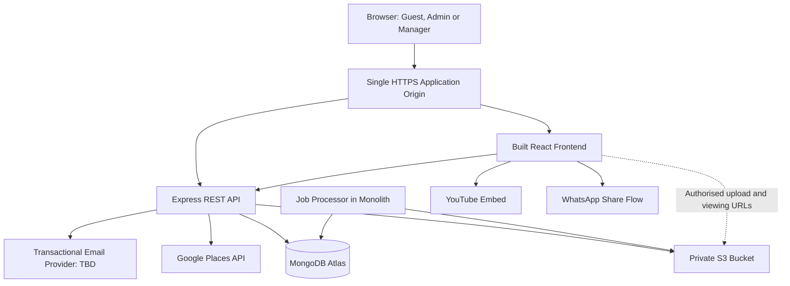
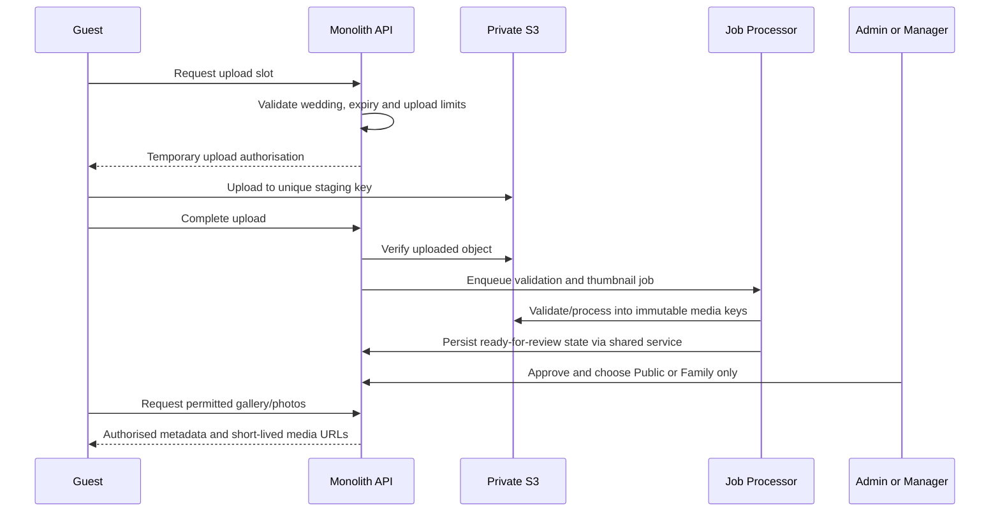

# Wedding Application — System Architecture

Version: 1.0  
Date: 15 October 2026  
Status: Approved architecture baseline; hosting and email providers to be selected  
Product requirements: [PRD](./PRD.md)

## 1. Architecture decisions

| Area | Decision |
| --- | --- |
| Application style | Modular monolith: one repository, one backend application |
| Frontend | React, TypeScript, Vite |
| Backend | Node.js on a supported LTS release, Express, TypeScript, REST API |
| Database | MongoDB Atlas cluster, shared database and collections |
| Photo storage | Private Amazon S3 bucket for originals and thumbnails |
| Authentication | Email/password, secure server-side sessions stored in MongoDB |
| Access | Admin, Manager, Guest; each authenticated account belongs to one wedding |
| Deployment | Same-origin frontend and API; hosting provider selected later |
| Background work | Durable MongoDB jobs processed by the monolith |
| Guest schedule updates | Poll every 20–30 seconds while the page is active |
| Vendor search | Backend integration with Google Places Text Search |
| Streaming and sharing | YouTube embed and user-initiated WhatsApp sharing |
| URL date | DD-MM-YYYY, with a short random suffix on collision |
| Photo volume | Approximately 200 photos per wedding; planning estimate, not a hard cap |
| Photo retention | Through the end of day seven after the main wedding date, in the wedding timezone |

The application supports multiple weddings concurrently. An account cannot create, join, or switch to a second wedding. External database, storage, and API services do not change the monolithic application structure.

## 2. System overview



The Node.js deployment serves the built React assets, selected HTML metadata, and `/api/v1` routes. Backend business logic is grouped by feature. React contains presentation and interaction logic; permission enforcement remains on the server.

## 3. Application modules

| Module | Responsibilities |
| --- | --- |
| Auth and team | Registration, login/logout, sessions, password reset, Manager invitations and revocation |
| Weddings | Wedding identity, main date, timezone, stable slug, publication, theme configuration |
| Events | Event details, contacts, announcements, manual ceremony status, revision tracking |
| Invitations | Family records, invited event references, personal access tokens, manual sent state, estimates |
| Tasks | Event/general tasks, optional assignee and deadline, status and overdue queries |
| Expenses | Expense records, embedded payments, payer information, calculated totals |
| Photos | Upload authorisation, processing, moderation, visibility, private link access, retention and export |
| Vendors | Google query construction, field selection, response handling, quotas and attribution |
| Jobs | Durable thumbnail, cleanup, retention and export jobs, retries and leases |

Suggested repository layout:

```text
client/src/
  app/                 routing, providers, API client
  features/            dashboard and guest features
  themes/              three presentation variants
  components/          shared UI
server/src/
  modules/             feature modules with routes, services and repositories
  middleware/          sessions, role checks, validation, errors
  integrations/        MongoDB, S3, Google Places, email
  jobs/                durable job execution
  app.ts               HTTP application composition
shared/                API contracts and reusable validation types
```

This is a proposed code layout, not a dependency on a particular hosting vendor or database library. Pin library versions during implementation.

## 4. Frontend and themes

- React serves the guest website and private dashboard with separate route layouts.
- All three themes consume the same wedding data contract and permission-filtered APIs.
- Theme configuration contains a theme identifier and supported content/colour settings; switching themes never copies or deletes wedding data.
- Guest pages include Today, Events, Personal Invitation, Photos, Private Gallery, and Live Stream.
- Management pages include Overview, Website, Events, Tasks, Invitations, Expenses, Photos, Vendors, Streaming, and Team.
- Server-generated page titles and social metadata describe the wedding for WhatsApp previews. Do not include family names from personal invitations, secret tokens, or private photos in preview metadata.
- Poll the schedule every 20–30 seconds while active; pause in hidden tabs, refresh on return, and back off on errors. Display last successful update and an error state when necessary.
- Save event revisions using optimistic concurrency. Reject stale edits and let the editor reload/reconcile rather than silently overwrite another person's update.

## 5. Routes and wedding addresses

Example wedding date: 14 February 2027.

```text
/w/avani-swar-14-02-2027
/w/avani-swar-14-02-2027/events
/w/avani-swar-14-02-2027/photos
/w/avani-swar-14-02-2027/invite/<random-token>
/w/avani-swar-14-02-2027/family-gallery/<random-token>
/w/avani-swar-14-02-2027/upload
/dashboard
```

- Normalise couple names into a readable slug and append the main wedding date in **DD-MM-YYYY**.
- Enforce a unique database index on the slug. If creation conflicts, append a short random suffix and retry, for example `avani-swar-14-02-2027-k7m2`.
- Freeze the slug on first publication. Later date/name corrections update content but preserve distributed links and QR codes.
- Use immutable wedding IDs internally; never infer ownership or retention from the URL text.
- Store the main wedding date as an unambiguous calendar date (`YYYY-MM-DD`) and timezone separately. Internal storage format does not change the approved URL/display format.

## 6. Authentication and access control

### Accounts and sessions

- Register using email/password; normalise email and enforce uniqueness.
- Hash passwords with a maintained password-hashing implementation such as Argon2id. Never store plaintext or reversible passwords.
- Store opaque session identifiers in Secure, HttpOnly cookies with appropriate SameSite policy; store session state and expiry in MongoDB.
- Rotate session identifiers at login and invalidate sessions at logout, account disablement, and sensitive credential changes.
- Validate session expiry in application code, regardless of when MongoDB TTL cleanup removes the record.
- Protect state-changing cookie-authenticated requests against CSRF and enforce rate limits on login, recovery, public upload, and token exchange routes.
- Manager invitations and password-reset tokens are random, hashed at rest, expiring, and single-use. Email delivery uses a provider chosen later.
- The wedding creator becomes Admin. Manager setup links grant access only to that Admin's wedding. An existing account associated with another wedding cannot accept them.

### Wedding isolation

- Each account has exactly one `weddingId` after completed setup. Wedding creation and Admin association must commit together, or be safely recoverable and idempotent.
- For management operations, derive `weddingId` from the authenticated session, not a client-supplied value.
- Every wedding-owned query includes the wedding boundary, including reads, updates, deletes, job payloads and media requests.
- Validate that linked event IDs, task assignees, invitation events, and photo IDs belong to the same wedding.
- Public routes resolve the wedding from its slug and return only explicitly allowed published fields.
- Apply the PRD's fixed Admin/Manager permissions. Only Admin manages team access; both manage operational data and photo approval.

### Private family gallery

- Store a hash of the private-link token and a link generation/version on the wedding or a dedicated access record.
- Exchange the token for a scoped gallery session, then remove the token from the browser address where practical. The session grants viewing only for that wedding and link generation.
- Replacing/disabling the link invalidates old tokens and derived gallery sessions. Every new media authorisation checks the current generation and photo expiry.
- Keep secret tokens out of logs, analytics, referrer headers, public navigation, search indexing and third-party embeds on the private page.
- Link holders may forward access. No identity verification is promised, and downloaded copies cannot be revoked.

## 7. MongoDB model and indexes

| Collection | Main fields | Important indexes |
| --- | --- | --- |
| users | email, passwordHash, role, weddingId, account state | unique normalised email; weddingId |
| sessions | session reference, userId, expiry | unique session reference; TTL expiry |
| weddings | couple details, main date, timezone, slug, theme, published state, photoExpiryAt, private gallery generation | unique slug |
| events | weddingId, schedule, venue, contacts, status, revision | weddingId + startAt |
| invitations | weddingId, family contact, selected event IDs, token hash, sent state/time | unique token hash; weddingId + sent state |
| tasks | weddingId, optional eventId, title, assignee, due date, status | weddingId + status + due date |
| expenses | weddingId, event/general, category, costPaise, payment entries | weddingId + eventId; weddingId + category |
| photos | weddingId, event/general, uploader submission, source, object keys, processing/moderation/audience states, expiry | weddingId + approval + audience + eventId |
| jobs | type, payload references, status, attempts, nextRunAt, leaseUntil | status + nextRunAt; unique idempotency key |
| authTokens | purpose, token hash, wedding/user association, expiry, used state | unique token hash; TTL expiry |

Embed small bounded information such as event contacts and individual expense payments. Keep growing groups such as photos, tasks, events and invitations in separate documents.

Store money in integer paise; derive paid and outstanding amounts from expense/payment data. Use atomic document updates and revision checks for expense edits. Multi-document transactions are reserved for operations that need all-or-nothing consistency.

Database TTL indexes are cleanup aids, not permission or scheduled-deletion guarantees. Backups and restore testing must be configured for the selected Atlas plan before the pilot.

## 8. Photo lifecycle



- All S3 objects remain private, including guest-visible photos. Public means the API may authorise anonymous viewing of an approved public photo.
- Use unique staging keys and size-constrained upload authorisation. Validate actual bytes, dimensions, format, size and expected ownership after upload.
- Processing writes to immutable final keys and strips unnecessary metadata, including location metadata. A staging upload URL cannot overwrite the approved original or thumbnail.
- Separate processing state (`uploading`, `processing`, `ready`, `failed`), moderation (`pending`, `approved`, `rejected`), and audience (`public`, `family_only`).
- New unclassified photos default to family-only. Guest photos require approval; team photos may be approved immediately after processing and an explicit audience choice.
- Public gallery queries require ready + approved + public. Private gallery queries require ready + approved and valid family access. Management access can view moderation candidates while unexpired.
- Apply the same filter to thumbnails, originals, counts, collections and download/export requests.
- Issue viewing URLs with a short lifetime, proposed maximum five minutes and never beyond the wedding's photo expiry. Existing URLs may work until expiry after a visibility or link change; document this behaviour in management UI.
- No permanent public S3 URLs or public bucket listing. Use constrained bucket CORS for direct browser uploads.
- Clean up incomplete staging uploads separately from approved media. Use file limits and upload throttling; 200 is an expected volume, not an enforced wedding limit.

## 9. Seven-day retention and downloads

- Compute `photoExpiryAt` from the main wedding calendar date and timezone: midnight at the start of the eighth day after that date.
- Example: main date 14-02-2027 in Asia/Kolkata → available through 21-02-2027 → access closes at 00:00 on 22-02-2027.
- Retention is anchored to the main wedding date, not each upload date, event date, or the date embedded in the frozen slug.
- Refuse new uploads and all gallery/media/download authorisation at or after expiry, including for the team. Show the expiry date prominently before that point.
- Immediately enforce expiry at request time even if the deletion job is delayed. The job removes originals, thumbnails, staging objects and temporary exports, retrying failures.
- If S3 versioning is enabled, delete retained object versions too. Configure lifecycle/backup policies so they do not silently preserve expired photos beyond the promised retention policy.
- Keep only minimal deletion status metadata as needed to verify cleanup. Expiring photos does not delete the website, tasks or expenses.
- If the main date changes before expiry, recalculate expiry and reschedule cleanup using a version check. Never resurrect media already deleted.
- Provide team download access before expiry. For the proposed download-all flow, a background export job creates an authorised temporary archive; its lifetime is no later than photo expiry. Private files cannot appear in public exports.
- Storage deletion is asynchronous; guest access ends at the deadline while cleanup completes with retries. Downloaded copies are outside the application's control.

## 10. Background jobs

The initial deployment runs a bounded job processor alongside the API using the same modules and database. Image work must not block HTTP request handling; use worker threads/subprocesses or nonblocking library execution as appropriate, with resource limits.

- Claim jobs atomically with a lease. Renew the lease during long jobs; expired leases allow recovery after a crash.
- Use idempotency keys, bounded retries, backoff, and a failed-job view/log for manual retry.
- Periodically scan for expired photos and abandoned uploads so a missing scheduled job cannot leave media accessible or permanently retained.
- Recheck wedding expiry and photo state before publishing processing/export results.
- More than one application instance must not duplicate effects; leases and idempotent handlers are mandatory from the beginning.
- If load later requires it, run the same job code in a separate process without splitting feature modules into microservices.

## 11. External services

| Integration | Behaviour |
| --- | --- |
| Google Places | Server-side Text Search with service/location, minimal requested fields, quotas, attribution and compliant caching |
| YouTube | Browser embed with external fallback; no video ingestion or hosting |
| WhatsApp | Client opens a prefilled message; sent status remains a manual team action |
| Email | Manager setup and password recovery messages; provider selected with hosting |
| S3 | Backend issues scoped temporary upload/viewing permissions; credentials never reach the browser |

Vendor results are provider listings, not an exhaustive directory or availability guarantee. Distinguish source failures from zero results. Follow Google display and storage policies rather than building a permanent copy of its listings.

## 12. API conventions

Use `/api/v1` with resource-oriented routes. Illustrative groups:

```text
/auth/login, /auth/logout, /auth/password-reset
/wedding, /team
/events, /announcements, /tasks
/invitations, /expenses
/photos/uploads, /photos, /photos/moderation
/gallery-access, /photo-exports
/vendors/search
/public/weddings/:slug
```

- Validate request bodies and limits centrally; return consistent error codes and field errors.
- Paginate galleries, invitations and vendor results where supported.
- Use idempotency for uploads, payment additions and exports where retries could create duplicates.
- Management APIs always use session-derived wedding scope. Public endpoints explicitly check publication, link access and photo expiry as applicable.
- Invitation tokens grant access to a family's invitation only. They never grant private-gallery or management permissions.

## 13. Deployment and operations

- Package the Node.js application and built React assets in a portable container or equivalent build artifact.
- Use one HTTPS origin initially. Configure proxy trust and cookies for the chosen hosting platform.
- Select hosting near the primary users and align application, Atlas and S3 regions where practical.
- Provide separate development and production configuration, credentials, databases and storage prefixes/buckets.
- Keep secrets in managed environment/secret configuration. Limit S3 credentials to required bucket operations and Atlas access to application needs.
- Log errors, job failures, slow requests and operational counts without credentials, secret URLs or unnecessary personal details.
- Monitor availability, upload failure rate, pending moderation count, job backlog, deletion lag, database/storage use and Google API spend.
- Set application and database health checks. On shutdown, stop claiming jobs and gracefully finish or release leased work.
- Hosting size and backup settings will follow the provider decision and a realistic pilot load test. The architecture does not assume a fixed number of concurrent weddings.

## 14. Verification before the pilot

- Create two weddings and verify cross-wedding access is denied for every private resource.
- Verify Admin/Manager permissions and that a single account cannot join a second wedding.
- Verify slug format `DD-MM-YYYY`, uniqueness retries and stable published links after date edits.
- Switch all three themes without losing content, links or permissions.
- Check stale event edits and polling behaviour across two browsers.
- Confirm invitation estimates count unique sent families and selected events correctly.
- Reconcile integer-paise expense/payment totals and retry behaviour.
- Test upload validation, staging overwrite resistance, partial failures and moderation filters.
- Verify private-link rotation, temporary URL lifetime and media protection across all gallery paths.
- Test expiry boundaries in the wedding timezone, delayed cleanup, job recovery and original/thumbnail/export deletion.
- Test roughly 200 photos per wedding plus concurrent guest browsing on a representative mobile connection.
- Test Google failures, denied geolocation, password recovery and Manager setup.

## 15. Remaining implementation choices

The core architecture is approved. These choices remain for implementation planning:

- Hosting provider, deployment region and initial capacity.
- Transactional email provider and sender domain.
- Exact package versions, MongoDB access library, and UI component library.
- Final theme visual designs.
- HEIC processing support and final file-size/batch limits.
- Google API usage budget, Atlas backup plan and S3 lifecycle configuration.

No further product decision is needed to begin technical design within this baseline.

## References

- [React: building an app from scratch](https://react.dev/learn/build-a-react-app-from-scratch)
- [MongoDB Atlas: multi-tenant architecture](https://www.mongodb.com/docs/atlas/build-multi-tenant-arch/)
- [Amazon S3: presigned URLs](https://docs.aws.amazon.com/AmazonS3/latest/userguide/using-presigned-url.html)
- [Google Places: Text Search](https://developers.google.com/maps/documentation/places/web-service/text-search)
- [Google Places: policies and attribution](https://developers.google.com/maps/documentation/places/web-service/policies)


## M2 email foundation — 18 October 2026

Manager setup/recovery and the first durable `auth_email` worker are implemented. Resend is the selected adapter; sender/domain provisioning and real delivery remain unverified. Development uses a private local outbox by default; production email is disabled until explicitly configured. MongoDB jobs use leases, version fencing, bounded retries and a stable provider idempotency key. Queued email envelopes are separately authenticated/encrypted and cleared on terminal outcomes; identity-token storage remains hash-only. No queue service, family campaign dispatch, photo worker or production deployment has been added. See TEAM_RECOVERY.md and PROJECT_STATUS.md for configuration and verification limits.


## M4A manual invitation foundation — 18 October 2026

The invitation module now supports family records, selected ceremony highlights, recoverable personal links, manual WhatsApp/copy sharing, manual Sent tracking and unique-family estimates. Both team roles manage operational records; personal capabilities grant no management/gallery permissions and return only the family greeting plus the full safe guest model. Separate invitation encryption keys remain outside MongoDB, with hash lookup and version-bound authenticated ciphertext. Invitation mutations and audit entries share a transaction; a parent wedding write fence coordinates selections with ceremony archive. See INVITATIONS_IMPLEMENTATION.md and PROJECT_STATUS.md for exact contracts, verification and operating limits. M4B family email dispatch and its policy/provider acceptance remain pending; no new job type or scheduler is enabled.
